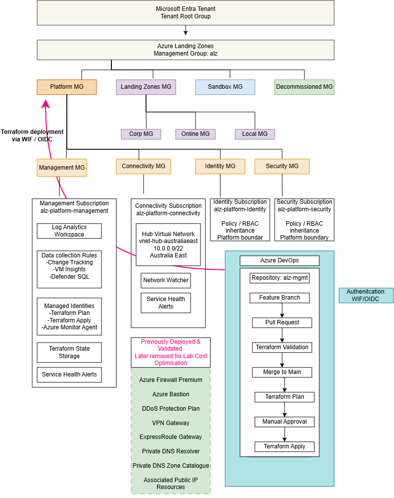

# Azure Landing Zone Platform Lab

## Overview

This project implements a Microsoft-aligned Azure Landing Zone platform using the Azure Landing Zones IaC Accelerator, Terraform, Azure Verified Modules, Azure DevOps, and workload identity federation.

The objective was to build and operate the platform layer of an enterprise-style Azure environment, including management groups, dedicated platform subscriptions, governance, centralized management services, hub networking, infrastructure as code, and controlled CI/CD deployment.

The project is separated into two phases:

- **Phase 1 - Platform Landing Zone**: governance, platform subscriptions, shared management services, connectivity foundation, Terraform state, and Azure DevOps delivery controls.
- **Phase 2 - Application Landing Zone**: workload subscriptions, spoke networking, AKS, ACR, Key Vault, workload identity, observability, and application delivery pipelines.

This repository documents **Phase 1 - Platform Landing Zone**.

> This is a non-production engineering lab designed to demonstrate enterprise Azure platform patterns and operational practices.

## Architecture



The platform uses the Azure Landing Zone management-group hierarchy with dedicated subscriptions for Management, Connectivity, Identity, and Security.

Detailed architecture, management-group hierarchy, subscription responsibilities, connectivity design, and platform/application separation are documented in [Architecture](docs/architecture.md).

## What Was Implemented

- Azure Landing Zone management-group hierarchy
- Dedicated Management, Connectivity, Identity, and Security subscriptions
- Azure Policy and RBAC inheritance
- Centralized Log Analytics and management resources
- Data Collection Rules
- Terraform plan and apply managed identities
- Remote Terraform state storage
- Hub virtual network in Australia East
- Azure DevOps CI and CD pipelines
- Pull request validation and protected branch workflow
- Terraform plan, manual approval, and apply process
- Workload identity federation / OIDC
- Cost-optimized parked state
- Final Terraform reconciliation with no remaining drift

## Technology Stack

- **Cloud Platform:** Microsoft Azure
- **Landing Zone Framework:** Azure Landing Zones IaC Accelerator
- **Infrastructure as Code:** Terraform
- **Module Framework:** Azure Verified Modules
- **Source Control:** Azure Repos
- **CI/CD:** Azure DevOps Pipelines
- **Authentication:** Workload Identity Federation / OIDC
- **Governance:** Azure Policy, Azure RBAC, Management Groups
- **Monitoring:** Azure Monitor, Log Analytics, Data Collection Rules
- **Networking:** Hub-and-Spoke Virtual Network
- **State Management:** Azure Storage remote Terraform state
- **Region:** Australia East

## Platform Design

The platform separates shared governance and operational services from future application workloads.

Dedicated Management, Connectivity, Identity, and Security subscriptions provide clear platform boundaries, while future Application Landing Zones can consume the shared platform foundation without recreating it.

See [Architecture](docs/architecture.md).

## CI/CD and Change Control

Azure DevOps manages infrastructure changes through feature branches, pull requests, Terraform validation, merge controls, Terraform plan, manual approval, and Terraform apply.

Pipeline authentication uses workload identity federation / OIDC rather than long-lived deployment secrets.

See [CI/CD and Change Control](docs/cicd.md).

## Governance and Security

Governance is applied through the Azure Landing Zone management-group hierarchy using Azure Policy and Azure RBAC.

Separate deployment identities, pull request validation, protected branches, and manual approval provide additional infrastructure change controls.

See [Governance and Security](docs/governance.md).

## Monitoring and Management

The Management subscription provides shared operational services including Log Analytics, Data Collection Rules, deployment identities, Terraform state, and Service Health alerting resources.

## FinOps

Higher-cost connectivity services were deployed and validated during the project, then removed or disabled to create a manageable parked lab state while retaining the core platform foundation.

See [FinOps and Cost Optimisation](docs/finops.md).


## Validation

The final platform state was reconciled through Azure DevOps and Terraform.

Final Terraform plan:

```text
No changes. Your infrastructure matches the configuration.
```

Final Terraform apply:

```text
Apply complete! Resources: 0 added, 0 changed, 0 destroyed.
```

Detailed validation evidence is available in [Platform Verification](docs/verification.md).

## Documentation

- [Architecture](docs/architecture.md)
- [CI/CD and Change Control](docs/cicd.md)
- [Governance and Security](docs/governance.md)
- [FinOps and Cost Optimisation](docs/finops.md)
- [Platform Verification](docs/verification.md)
- [Troubleshooting and Engineering Lessons](docs/learning/troubleshooting-and-lessons.md)

## Project Status

**Phase 1 - Platform Landing Zone: Complete**

The platform has been deployed, validated, cost-optimised for lab use, and reconciled to a clean Terraform state.

Release milestone:

```text
v1.0-alz-platform-lab
```

The next phase will build an Application Landing Zone using this platform foundation.