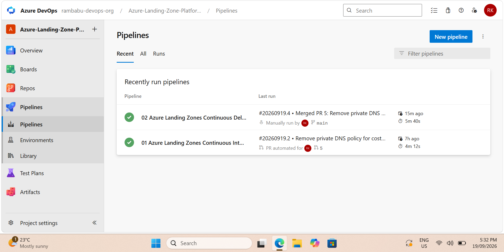
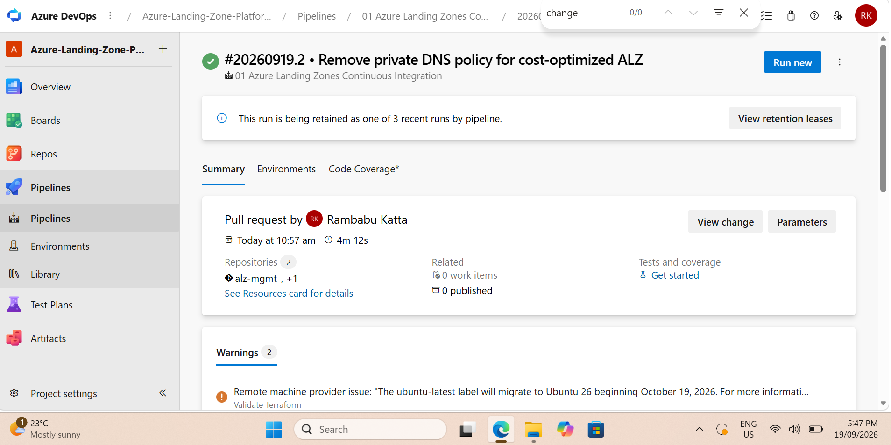
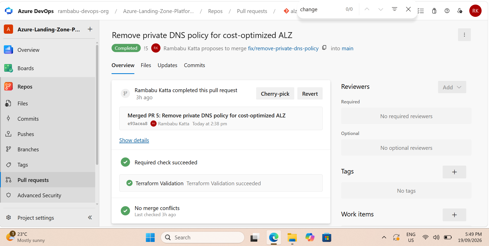
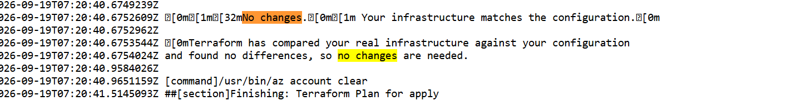
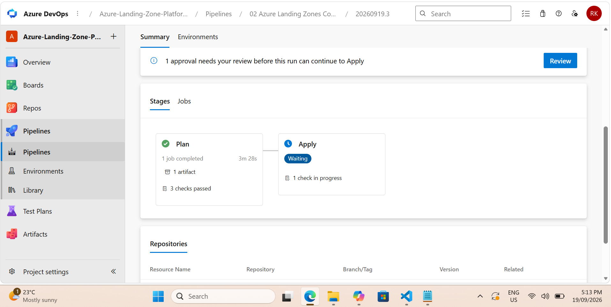
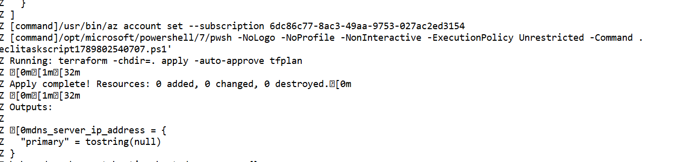

# CI/CD and Change Control

## Overview

Azure DevOps is used to manage and deploy infrastructure changes for the Azure Landing Zone platform.

The delivery workflow uses feature branches, pull requests, Terraform validation, deployment planning, manual approval, and Terraform apply.

Authentication to Azure is performed using workload identity federation / OIDC rather than long-lived deployment secrets.

## Delivery Workflow

```text
Feature Branch
      |
      v
Pull Request
      |
      v
Terraform Validation
      |
      v
Merge to Main
      |
      v
Terraform Plan
      |
      v
Manual Approval
      |
      v
Terraform Apply
```

This workflow provides controlled infrastructure change management and separates validation from deployment.

## Azure DevOps Pipelines

The platform uses two generated Azure DevOps pipelines:

- `01 Azure Landing Zones Continuous Integration`
- `02 Azure Landing Zones Continuous Delivery`

The CI pipeline validates infrastructure changes before merge.

The CD pipeline performs Terraform planning and deployment after changes are merged to `main`.



## Pull Request Validation

Infrastructure changes are made on feature branches and submitted through pull requests.

The protected `main` branch requires successful Terraform validation before changes are merged.





## Workload Identity Federation

Azure authentication for the pipelines uses workload identity federation / OIDC.

This removes the need to store long-lived Azure client secrets in the pipeline configuration.

Separate managed identities are used for Terraform plan and apply operations.

## Terraform Plan

After changes are merged to `main`, the delivery pipeline generates a Terraform plan so infrastructure changes can be reviewed before deployment.

The final reconciliation plan confirmed that the deployed Azure resources, Terraform state, and repository configuration were aligned.



## Manual Approval

The Terraform apply stage is protected by a manual approval gate.

This prevents automatic infrastructure deployment immediately after the plan stage and provides an explicit change-control checkpoint before applying changes.



## Terraform Apply

After approval, the Terraform apply stage deploys the reviewed plan using the apply identity.

The final reconciliation completed with:

```text
Apply complete! Resources: 0 added, 0 changed, 0 destroyed.
```



## Change-Control Principles

The platform delivery process demonstrates the following controls:

- Branch-based infrastructure changes
- Pull request review and validation
- Protected `main` branch
- Terraform validation before merge
- Terraform plan before deployment
- Manual approval before apply
- Workload identity federation / OIDC
- Separate Terraform plan and apply identities
- Remote Terraform state
- Infrastructure reconciliation and drift verification

Together, these controls provide a repeatable and auditable deployment workflow for the platform.
