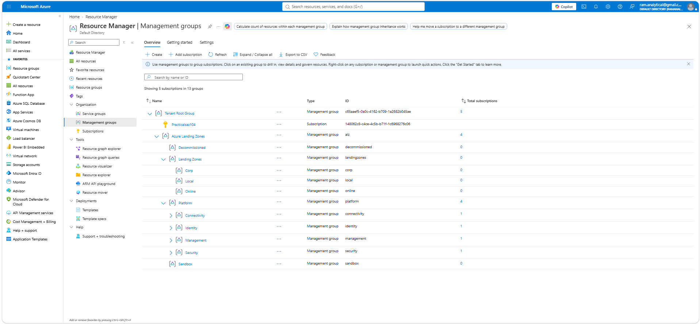
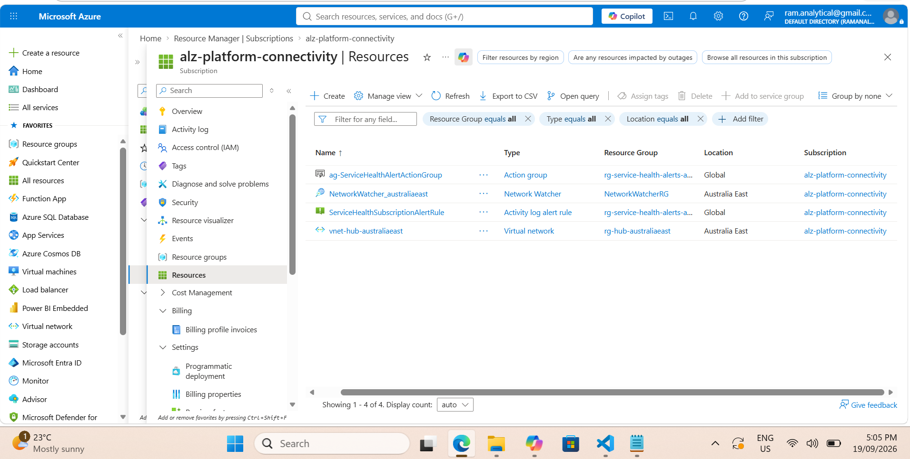
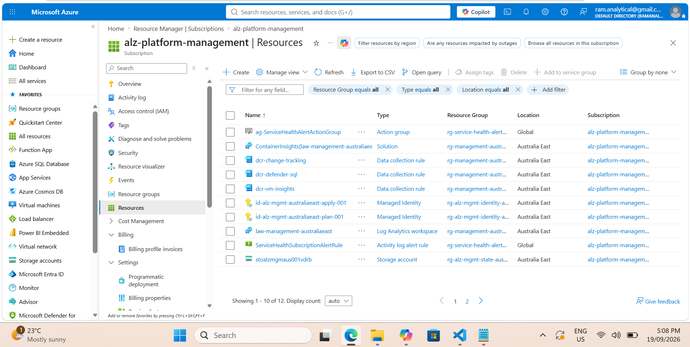
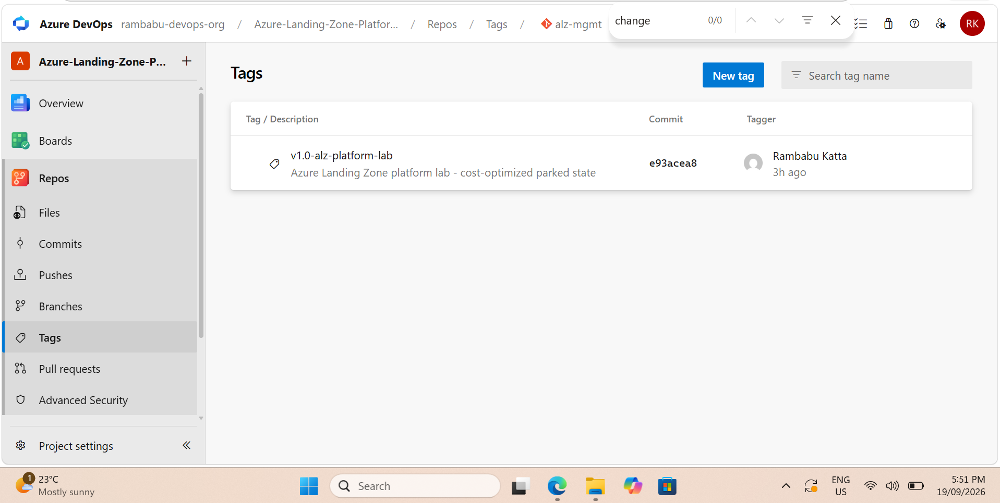

# Platform Verification

## Overview

The final platform state was verified across Azure, Azure DevOps, and Terraform to confirm that the deployed resources, repository configuration, and Terraform state were aligned.

## Management Group Verification

The Azure Landing Zone hierarchy was validated to confirm the expected platform structure and subscription placement.



## Connectivity Subscription Verification

The Connectivity subscription was reviewed to confirm the final cost-optimized parked state.

The retained resources include the hub virtual network, Network Watcher, and Service Health alerting resources.



## Management Subscription Verification

The Management subscription was reviewed to confirm the retained shared operational resources, including monitoring, Terraform state, deployment identities, and management services.



## CI and Pull Request Validation

Infrastructure changes were validated through the Azure DevOps CI workflow before merge.


Completed pull request validation confirmed that the required Terraform validation checks had passed.


## Manual Approval Verification

The CD workflow includes a manual approval gate before Terraform apply.


## Final Terraform Plan

The final Terraform reconciliation returned:

```text
No changes. Your infrastructure matches the configuration.
```


This confirmed that the deployed infrastructure matched the Terraform configuration.

## Final Terraform Apply

The final apply completed with:

```text
Apply complete! Resources: 0 added, 0 changed, 0 destroyed.
```


## Release Milestone

The documented platform state was tagged as:

```text
v1.0-alz-platform-lab
```



## Verification Outcome

The final verification confirmed:

- Management-group hierarchy and platform subscriptions were in the expected structure
- Management and Connectivity subscriptions contained the intended retained resources
- CI validation and pull request controls were functioning
- Manual approval was enforced before deployment
- Terraform reported no remaining infrastructure drift
- Final apply completed with zero changes
- The documented platform state was captured with a release tag
